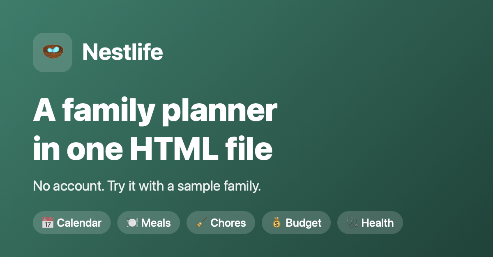

# Nestlife: a family planner in one HTML file

**Toolkit #1.** Try it, copy it, and see how it was made.

**[Open the demo](https://nestlifedemo.netlify.app)** · [How I made this](HOW-I-MADE-THIS.md)

## What it does

Nestlife covers the things a family keeps in its head: calendar, to-dos, meals, groceries, chores, budget, health, school, work and an emergency sheet. It also has an encrypted vault, printable reports, and CSV and calendar export.

- One HTML file, with no account, app server or build step
- The app saves your entries in your browser and doesn't upload them
- Free to use and change under the MIT license

## Make it yours

1. Download this repo (**Code → Download ZIP**).
2. Open `site/index.html` in a text editor and find `CONFIG` near the top of the script.
3. Set `demo: false`, so your entries are saved. Change `appName` and `tagline` if you like.
4. Open the file in your browser, or host it.

To host it, put the `site` folder on any static host. On Netlify, drag `site` onto the deploy page. To use it on a phone, open your hosted link and add it to the home screen.

> **Back up.** With `demo: false`, your planner lives in one browser at one address. Clearing browser data or changing the address means starting over, unless you export a backup from **Settings & backup**.

## What's here

| File | Purpose |
| --- | --- |
| `site/index.html` | The whole app |
| `site/manifest.webmanifest`, `site/icon-*.png` | Name and icons for the home screen |
| `site/preview.png` | Image shown when the demo link is shared |
| `site/_headers`, `netlify.toml` | Netlify settings |
| `HOW-I-MADE-THIS.md` | The process, for reuse on your own idea |

## Limits

- It doesn't sync between devices on its own. Export on one and import on the other.
- The vault uses AES-256-GCM with a key derived from your password. It hasn't had an independent security review, so don't make it the only place you keep something important.
- It's a planner, not medical, legal or financial advice.

## License

[MIT](LICENSE)
